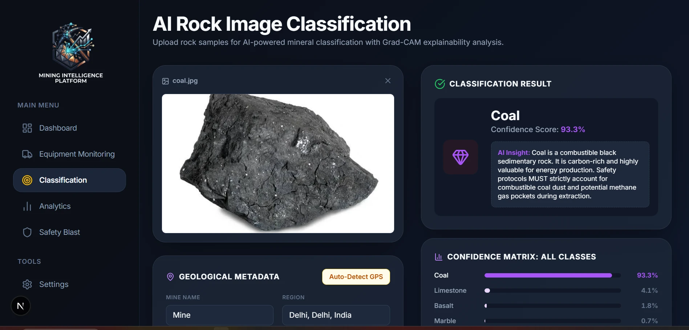
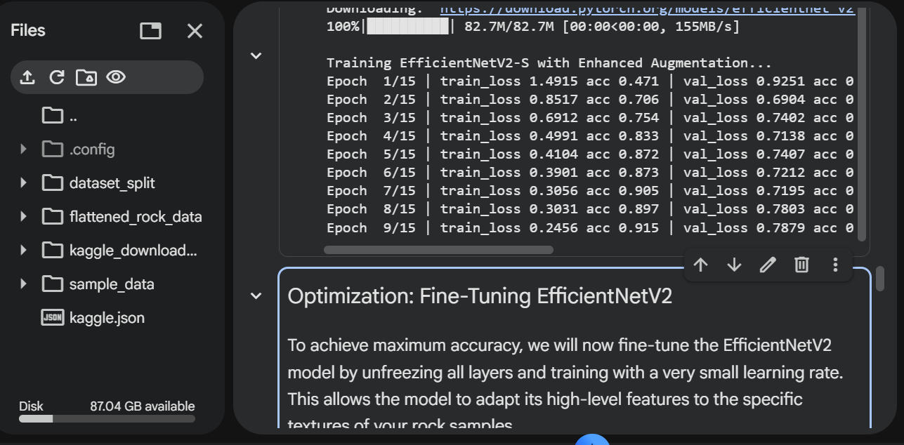
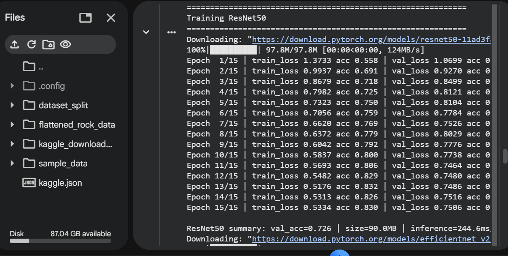
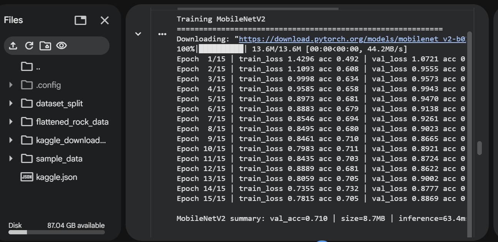

# Mining Intelligence Platform

The collective objective is to deliver an enterprise-grade, scalable, and extensible **Mining Intelligence Platform**. Real-time operational visibility, AI-driven insights, predictive analytics, safety monitoring, and blast intelligence must all be accessible from a single dashboard.

## 🎯 Final Integration Goal

At project completion, all six modules must interoperate through **secure REST APIs and shared authentication**, feeding into the Mining Operations Dashboard — the executive control centre of the entire platform.

## 🏗️ Architecture & Infrastructure

The platform is built using a modern, scalable tech stack:

### Services and Databases
- **PostgreSQL**: Relational database for structured operational data.
- **MongoDB**: NoSQL database for unstructured telemetry and logs.

### Core Structure
- `frontend/`: Next.js web application providing the executive command centre UI with Tailwind CSS.
- `backend/`: Core API services handling business logic, telemetry ingestion, and communication with the databases.
- `model/`: AI/ML models responsible for rock classification and predictive insights.
- `docs/`: Additional project documentation.

## 🪨 AI Rock Image Classification

The dashboard includes an AI module that identifies the rock type from a photo. A field operator uploads an image of a rock sample, and the platform returns the predicted rock type, a confidence score and a heatmap showing which part of the image the model focused on.



### How it works

1. **Upload**: a JPEG/PNG image is sent to the backend, optionally with mine name, region, GPS coordinates, operator and device ID.
2. **Preprocessing**: the image is resized to **224 × 224**, converted to RGB and normalised with ImageNet mean/std.
3. **Inference**: a fine-tuned **EfficientNetV2-S** (PyTorch) predicts one of 7 rock classes, and a softmax gives a probability for every class.
4. **Explainability (Grad-CAM)**: gradients from the last convolutional block build a heatmap of the regions that drove the prediction. It is returned as a side-by-side view: original image, heatmap and overlay.
5. **Insight**: a short geological explanation is added for the predicted rock, covering hardness, blastability and safety notes such as coal dust or silica dust.
6. **Storage**: the API responds right away. In the background, the original and Grad-CAM images go to Cloudinary, the result to PostgreSQL and the full geological metadata to MongoDB.

### Supported rock classes

| Class | Type | Mining relevance |
|-------|------|------------------|
| Basalt | Igneous | Very hard, needs high-energy drill-and-blast |
| Coal | Sedimentary | Combustible: watch for coal dust and methane |
| Granite | Igneous | High strength, abrasive on crusher parts |
| Limestone | Sedimentary | Moderate hardness, key for cement |
| Marble | Metamorphic | Dimension stone, precise extraction |
| Quartzite | Metamorphic | Very abrasive on drill bits |
| Sandstone | Sedimentary | Moderate blastability, silica dust risk |

### Model details

| Property | Value |
|----------|-------|
| Architecture | EfficientNetV2-S (fine-tuned) |
| Framework | PyTorch / torchvision |
| Input size | 224 × 224 × 3 |
| Classes | 7 |
| Test accuracy | **78.16%** |
| Explainability | Grad-CAM |
| Weights | `Mining_Operation_Dashboard/model/best_model.pth` |
| Config | `model/model_config.json`, `model/class_names.json` |

The model runs on GPU (CUDA) when one is available and falls back to CPU otherwise. It is loaded once as a singleton, so later requests stay fast.

### Model selection & training

Three ImageNet-pretrained CNNs were trained for 15 epochs on the same rock dataset split and compared on accuracy, size and speed:

| Model | Val accuracy | Model size | Inference time | Result |
|-------|--------------|------------|----------------|--------|
| MobileNetV2 | 71.0% | 8.7 MB | 63.4 ms | Fastest and smallest, but least accurate |
| ResNet50 | 72.6% | 90.0 MB | 244.6 ms | Heavy, with only a small accuracy gain |
| **EfficientNetV2-S** | **78.16% (test)** | ~78 MB | | ✅ **Selected** |

EfficientNetV2-S was trained with enhanced augmentation and then **fully fine-tuned**: all layers were unfrozen and trained with a very small learning rate, so its high-level features adapt to rock textures. This made it the most accurate of the three, so it is the model used in production.

<details>
<summary>📈 Training logs (click to expand)</summary>

**EfficientNetV2-S: enhanced augmentation, then fine-tuning**



**ResNet50**



**MobileNetV2**



</details>

### API endpoints

All routes are under `/api/v1`:

| Method | Endpoint | Description |
|--------|----------|-------------|
| `POST` | `/classify/` | Upload an image (`file`) and get the prediction, confidence, all class probabilities and AI explanation |
| `GET` | `/classify/results` | Paginated history, filterable by `mine_name`, `region` and `predicted_class` |
| `GET` | `/classify/results/{id}` | A single classification result |
| `GET` | `/classify/stats` | Total count and per-class distribution with average confidence |

Example:

```bash
curl -X POST http://localhost:8000/api/v1/classify/ \
  -F "file=@rock.jpg" \
  -F "mine_name=North Pit" \
  -F "region=Jharkhand"
```

Example response:

```json
{
  "status": "success",
  "data": {
    "predicted_class": "Granite",
    "confidence": 0.9132,
    "all_probabilities": { "Basalt": 0.021, "Granite": 0.9132, "...": "..." },
    "gradcam_available": true,
    "ai_explanation": "Granite is a coarse-grained intrusive igneous rock..."
  }
}
```

More detail is in [`Mining_Operation_Dashboard/docs/ai_model_documentation.md`](Mining_Operation_Dashboard/docs/ai_model_documentation.md).

## 🛠️ Getting Started

### Prerequisites

Ensure you have [Docker](https://www.docker.com/) and [Docker Compose](https://docs.docker.com/compose/) installed on your machine.

### Infrastructure Setup

Start the core infrastructure (PostgreSQL, MongoDB, MinIO, Redis) using Docker Compose:

```bash
docker-compose up -d
```

### Services Available on Localhost:
- **PostgreSQL**: `localhost:5432`
- **MongoDB**: `localhost:27017`

### Development

To run the frontend dashboard:

```bash
cd frontend
npm install
npm run dev
```

The frontend will be accessible at [http://localhost:3000](http://localhost:3000).

## 📄 License

© 2026 Mining Intelligence Platform. All rights reserved.
